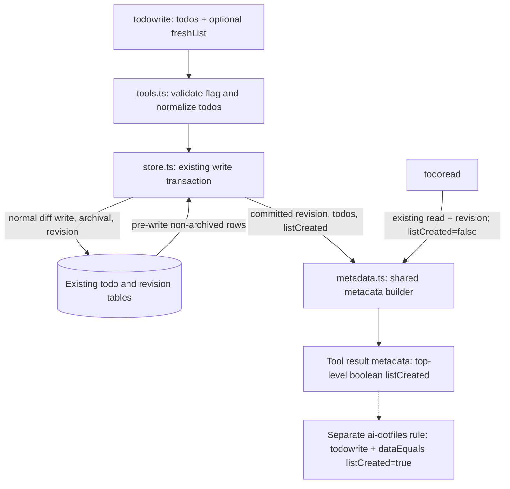

# Design: Explicit fresh todo lists

## Context

The reminder currently mistakes an all-pending list for list creation. The approved change replaces that heuristic with an operation-specific signal while permitting subsequent fresh lists in the same session and carryover of existing items.

Current boundaries are sufficient: `tools.ts` validates input and renders tool results; `Store.write` selects non-archived rows, matches identities, writes items, archives omissions, increments revision, and reads the resulting list in one transaction; `metadata.ts` builds the shared metadata shape. Both current capability specs, `todo-tools` and `todo-storage`, were read. The delta adds intent and a result field, not a new persisted entity.

Scope and compatibility are user constraints: existing tool calls and timestamp-aware store calls remain valid; no database migration, persistent list identity, UI change, new dependency, or auto-instruct source change. The separate ai-dotfiles configuration change and deployment are not part of this implementation.

## Goals / Non-Goals

**Goals**

- Accept optional boolean `freshList` on `todowrite` without requiring existing callers to change.
- Report creation independently of item statuses, from the successful write transaction.
- Preserve item IDs and existing timestamp, archival, ordering, and revision semantics even for explicit fresh writes.
- Expose top-level boolean `listCreated` in the metadata of both tools; reads always report false.

**Non-goals / YAGNI rejections**

- No list ID, list table, schema bump, or migration: the requested consumer needs an operation signal, not durable list identity.
- No status/content/replacement heuristic: these cannot reliably distinguish caller intent.
- No event bus, integration adapter, or new dependency: the existing metadata contract carries the signal.
- No retry deduplication or exactly-once reminder guarantee: repeated explicit intent is intentionally repeated signaling.
- No UI, instruction-file, unrelated validation, housekeeping, or broader concurrency redesign.

## Decisions

### D1 — Exact operation contract

**Behavioral requirements for the engineer to transcribe into delta specs:**

Active means all non-archived items for the calling session, including completed and cancelled items. Let `before` be those rows selected inside the write transaction and `after` be the list returned by that transaction. For a successful write:

`listCreated = after.length > 0 && (before.length === 0 || freshList === true)`

- Omitted `freshList` behaves as false; explicit false does not suppress automatic creation.
- Empty writes report false even with explicit true. They retain normal archival and revision behavior and do not reserve future fresh intent.
- A non-empty explicit fresh write reports true even if it retains every item unchanged. Repeating it reports true again.
- An unflagged replacement of a non-empty active list reports false, even if every item is new or all items are pending.
- Non-empty-after-empty reports true regardless of archived history or item statuses.
- Every successful `todoread` reports false, regardless of preceding writes. This is not a persisted property of the list.
- Errors return no successful creation result.

Options: infer creation from item changes/statuses, or combine transactional emptiness with explicit intent. Recommend the latter: it satisfies both automatic initial creation and caller-declared subsequent creation without introducing a list lifecycle model. The former remains ambiguous and violates approved semantics.

### D2 — Narrow store API extension and transaction ownership

Verified current signature: `write(sessionID, items, now = Date.now()): WriteResult`. Preserve the third positional timestamp argument. Extend it with a fourth optional boolean `freshList = false`; extend `WriteResult` with required boolean `listCreated`. The tool can pass `undefined` for the existing clock argument when forwarding intent, leaving clock ownership unchanged.

Options: append a boolean, or append an options object. Recommend the boolean: only one intent bit is needed now, it changes no existing calls, and an extensible options abstraction has no present justification. Replacing the timestamp argument with an object would unnecessarily break existing callers.

Compute the signal from the existing transaction's pre-write rows and resulting todos; return it with that transaction's revision/todos only after the transaction succeeds. Do not add a pre-read at the tool layer or re-read state to reconstruct the result after commit. The fresh flag must not alter identity matching, upserts, archival, timestamps, order, or revision increments.

Options: tool-side emptiness detection, or transaction-derived detection. Recommend transaction-derived detection: it reuses the authoritative snapshot and failure boundary, avoids read/write gaps, and adds no query or synchronization component.

Runtime validation rejects a supplied non-boolean flag before any mutation. The tool boundary validates raw input before calling the store; the store also guards its new boolean argument before entering the transaction so direct callers cannot bypass the contract. Omission uses the default. No general validation framework is introduced.

### D3 — Shared metadata propagation

Verified current builder: `buildMetadata(sessionID, revision, todos)`. Add a fourth boolean parameter defaulting to false and a required top-level `listCreated` field to `TodoMetadata`. `todowrite` forwards the transaction's returned boolean; `todoread` uses false. Keep all other metadata fields, text rendering, and database `schemaVersion` unchanged.

Options: infer the signal in the builder, or explicitly pass the operation result. Recommend explicit propagation: the builder has neither pre-write state nor caller intent, and reads must not replay creation. A default false preserves existing builder calls without adding another metadata shape.

The optional input is declared in the tool schema and explained in its description and README: explicit true marks a fresh non-empty list replacing an existing list, carryovers retain their IDs, and normal updates omit the flag. Invalid supplied values are rejected rather than coerced. Existing status defaulting is unchanged.

### Component flow

### Decision / component to observable requirement map

This is a specification bridge and component breakdown, not an implementation task sequence.

| Decision / part                     | Work kind             | Observable requirement / done-criterion                                                                                                                                                            | Capability     |
| ----------------------------------- | --------------------- | -------------------------------------------------------------------------------------------------------------------------------------------------------------------------------------------------- | -------------- |
| D1, D3: `tools.ts`                  | Application code      | Optional boolean intent is exposed and runtime-validated before mutation; old calls remain valid; write metadata follows the exact predicate; read metadata is always false                        | `todo-tools`   |
| D1, D2: `store.ts`                  | Application code      | Successful result binds signal, todos, and revision to the same transaction; rollback leaves no partial write; timestamp argument and existing item semantics remain intact                        | `todo-storage` |
| D3: `metadata.ts`                   | Application code      | Both tools expose a required top-level boolean alongside unchanged existing fields and schema version                                                                                              | `todo-tools`   |
| D1–D3: store/tool tests             | Application test code | Focused lifecycle coverage establishes automatic versus explicit creation, non-creation on updates/empty/read, invalid-flag rejection, and rollback; existing invariant tests remain authoritative | Both           |
| D1, D3: tool description and README | Documentation         | Callers can distinguish explicit fresh intent from ordinary updates and understand carryover IDs and operation-signal semantics                                                                    | `todo-tools`   |

Verification should include sequential successful writes to the same initially empty session, yielding true then false for ordinary writes. Reuse existing identity/timestamp/archive/order/revision coverage and add only fresh-intent-specific preservation assertions; do not duplicate the full invariant suite or claim overlapping-writer guarantees from sequential tests. No user-facing surface needs a UI-design pass.

## Risks / Trade-offs

- **Caller misuse:** marking an ordinary non-empty update fresh produces another reminder; failing to mark a subsequent fresh replacement suppresses it. Clear tool wording is the recovery path. This accepted ambiguity belongs to declared intent, not detection heuristics.
- **Invalid input or store failure:** reject malformed flags before mutation; existing transaction rollback protects todos and revision from partial writes. Failure remains visible through existing tool error handling. Blast radius remains the affected write; no creation field is stored to repair.
- **Concurrent writers:** use the existing write transaction and locking behavior without changes. Successful results describe their own transaction snapshot; no new retry, overlapping-writer success, or exactly-once delivery promise is introduced.
- **Result delivery failure after commit:** the signal is not durably replayed by reads. Explicit retries may signal again. This change does not attempt to make plugin hooks/config consumption transactional with storage.
- **Scaling:** deriving the boolean reuses rows already selected and the list already returned, adding constant computation and one metadata field. Existing full-list write costs and database contention characteristics are unchanged.
- **Compatibility:** database schema version stays unchanged because persistence is unchanged. Metadata is additive, not a persisted schema migration. Consumers using the old reminder heuristic require their separate config update to receive corrected behavior.
- **Rollout mismatch:** installing the new matcher before the plugin provides `listCreated` can suppress reminders. Keep external config work separately reviewed and deploy plugin-first.

## Migration Plan

No data migration or list backfill is required. Existing stored active lists remain ordinary non-empty lists until explicitly marked fresh or emptied and subsequently populated.

After implementation verification, obtain separate approval to install the updated plugin. Validate that the running plugin emits the expected write creation/update metadata and read false values before switching the reminder condition. Then, in the separate ai-dotfiles repository lifecycle, review the managed rule scoped to `todowrite` with `dataEquals` path `listCreated` and value true; obtain separate approval to apply that configuration. No ai-dotfiles or auto-instruct files are changed by this repo-local change.

If deployment must be rolled back, restore a compatible reminder rule before reverting to a plugin without the field; no database rollback is necessary.
