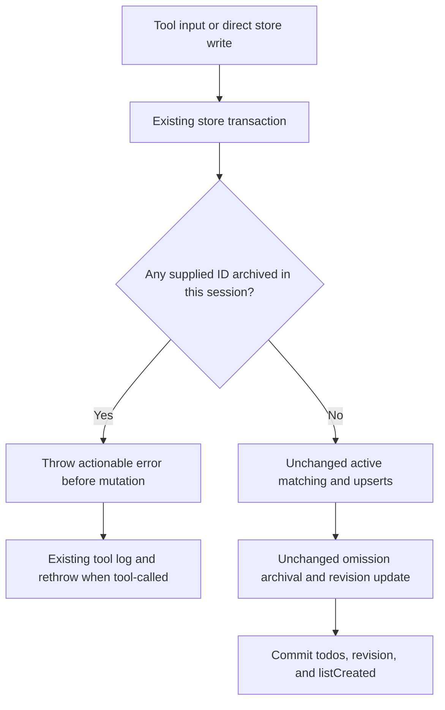

# Design

## Context

The store persists ordered, session-scoped todos with soft archival and a revision counter. `Store.write` already performs matching, upserts, omission archival, revision updates, and creation-result calculation in one transaction. The tool already logs and rethrows store errors.

This change addresses stale caller-supplied IDs, not list-creation signalling. The user approved rejecting an ID archived in the same session while preserving all stored todos and the revision. Unknown IDs and IDs archived only in other sessions remain acceptable. Existing scale and deployment remain unchanged; no new service or operational capacity is required. Failure tolerance is all-or-nothing rejection of the submitted batch.

### Diagnosis

Confirmed reproduction: IDs `1`/`2`/`3` are archived when a fresh list is written without IDs. A subsequent write reuses those stale IDs. Active-only matching misses the archived rows; the upsert updates them without clearing archival, and omission archival removes the current active list. The result is an empty list. Retrying without IDs then reports creation again.

The required delta is validation, not reactivation or a change to `freshList`/`listCreated`.

## Goals / Non-Goals

**Goals**

- Reject the complete write before any mutation if any supplied ID belongs to an archived row in the calling session.
- Preserve active and archived rows, timestamps, ordering, and revision on rejection.
- Identify the rejected ID and advise using a current item ID or omitting the ID.
- Preserve successful-write matching, archival, revision, and creation-result semantics.

**Non-goals**

- No schema migration, dependency, public signature, metadata, hook, or UI change.
- No archived-item restoration, automatic ID replacement, or broader input-validation redesign.
- No live installation or restart is authorized by this change.

## Decisions

### Reject stale identity rather than reinterpret it

| Option                            | Trade-offs                                                                                                                                                    |
| --------------------------------- | ------------------------------------------------------------------------------------------------------------------------------------------------------------- |
| Reject the complete batch         | Preserves history and the current list; makes incorrect identity explicit; requires a caller correction. Smallest change consistent with the approved policy. |
| Reactivate the archived row       | Avoids a retry but changes archival and history semantics, allowing stale input to resurrect removed items. Conflicts with the approved policy.               |
| Regenerate identity automatically | Avoids a retry but silently substitutes caller identity and may duplicate intent or lose historical continuity. Adds unnecessary recovery semantics.          |

**Recommendation: reject.** Atomic failure is resilient, existing transaction and error boundaries keep maintenance simple, and explicit identity correction is clearer than implicit restoration. No additional abstraction or recovery layer is justified.

### Validate within the existing store transaction

Inspect all supplied IDs for same-session archived membership before the transaction mutates any todo or revision. Use the existing session-scoped storage identity; do not impose global ID uniqueness. Keep active matching and the active pre-write list used for `listCreated` unchanged.

Alternatives are tool-only validation or validation outside the transaction. Tool-only validation leaves direct store writes unprotected; an outside preflight separates the check from the state being written. Neither improves simplicity or correctness over validation inside the existing transaction.

A rejection propagates through the existing tool log/rethrow path. No successful result or creation metadata is produced. `freshList: true` does not bypass validation.

### Behavioural requirements for delta specs

The engineer should transcribe the approved rejection contract into storage and tools delta specs. Qualify the genuinely-new-ID scenario to exclude same-session archived IDs, revision increments to apply to successful writes, and post-clearing creation to apply to successful writes with acceptable IDs. No spec is authored by this design pass.

### Component breakdown

| Part                                      | Kind of work                   | Done criterion                                                                                                                                                     |
| ----------------------------------------- | ------------------------------ | ------------------------------------------------------------------------------------------------------------------------------------------------------------------ |
| Store write validation                    | Application code               | Complete same-session archived-ID check precedes mutations; rejection preserves all rows and revision; active matching remains unchanged.                          |
| Store and tool regressions                | Application code / tests       | Atomicity, actionable error propagation, acceptance boundaries, and unchanged creation signals are demonstrated.                                                   |
| Recovery guidance and behaviour contracts | Documentation / OpenSpec specs | Recovery explains reading the current list and correcting identity while preserving the full intended list; contracts distinguish rejected from successful writes. |

No user-facing surface beyond the existing tool error and recovery documentation needs a UI-design pass.

## Risks / Trade-offs

- **Partial-batch mutation:** exercise a stale ID late in a mixed valid/stale batch, including `freshList: true`; assert active and archived rows, timestamps, ordering, and revision remain unchanged. Checking only immediately before each upsert is insufficient for the before-mutation requirement.
- **Empty active list:** archived history must still reject stale IDs even when there are no active items.
- **Over-broad rejection:** demonstrate acceptance of unknown IDs and IDs archived only in another session. A same-session archived match still rejects even if that ID exists elsewhere.
- **Creation-signal drift:** do not broaden active matching to include archived rows. With the existing non-empty active list preserved after failure, an ordinary corrected retry reports `listCreated: false`; after an actually empty list, existing creation rules still apply.
- **Recovery omissions:** advising ID omission does not waive full-list replacement semantics. Recovery guidance should tell callers to retain every current item they intend to keep.
- **Query cost:** validation adds reads proportional to supplied IDs and matching stored identities. Prefer the existing indexed session/item identity over scanning accumulated archived history; no new index, cache, or background process is justified.
- **Concurrent state changes:** keep validation and writes within the existing transaction boundary. Database contention retains the existing failure/retry behaviour; this change does not add a retry system or alter transaction mode.

Blast radius is the rejected write in the calling session; other sessions are unaffected. Recovery is to read current todos, correct supplied identity, and resubmit the full intended list. Existing databases need no migration or cleanup, and previously damaged lists are not automatically reconstructed. Deployment belongs to a separately authorized operational step.

### Review basis and method

Loaded `design-agent-common` and `documentation`; read the proposal, storage/tools specs, and store/tool implementation, and checked prior memory. The confirmed diagnosis was supplied and corroborated by source, so no fresh runtime diagnosis or troubleshooting procedure was needed. External version/API research is unnecessary: the design introduces no technology or new API dependency. Options, YAGNI exclusions, diagram, resilience profile, and component breakdown are recorded here. No implementation, git, build, test, installation, or restart action was performed. Durable-memory writes are omitted because the diagnosis is already recorded and this commission permits only this design file to be written.
